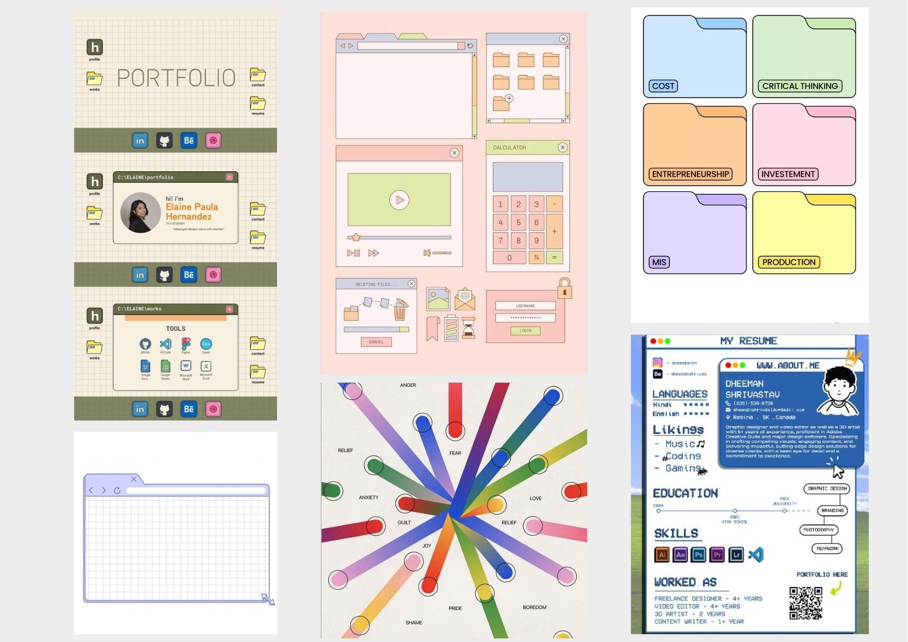
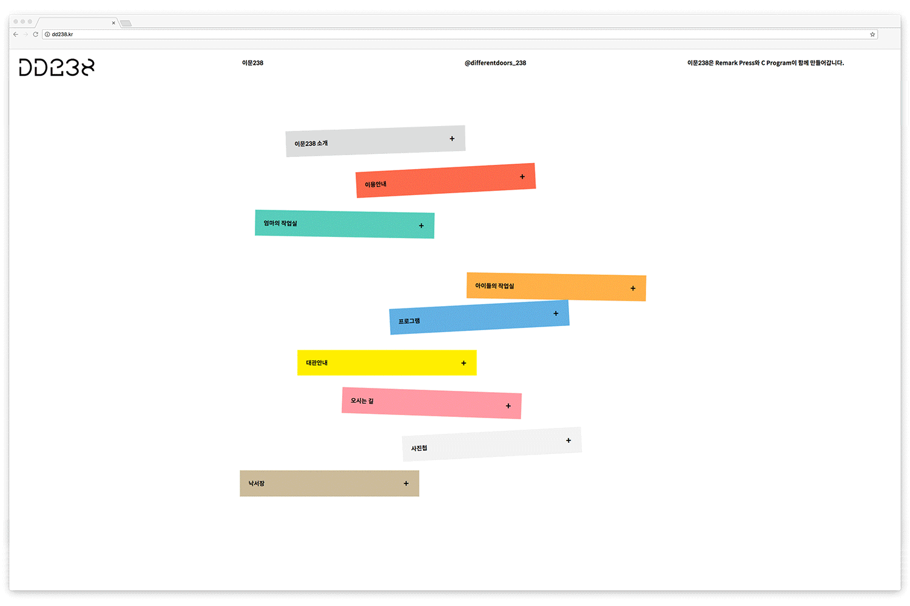

# Examen Interfaces Web

## Descripción proyecto

Realizaré la página web para mi portafolio, mostrando mis mejores proyectos a lo largo de la carrera. Quiero adoptar una estética tipo escritorio de computador, la cual quiero tomar una gama de colores vibrantes o pasteles y que esta página visualmente se vea atractiva y entretenida. 

La estructura de mi página web la quiero dividir en diferentes secciones, como lo son:

```Principal/inicio:``` En donde se visualizará un tipo de ilustración o interacción (está en veremos) a modo general, además del header con enlace a las siguientes pestañas.

```Proyectos:``` Visualizar proyectos destacados con sus respectivos nombres, mi idea es visualizarlos mediante "carpetas de computador o archivo", los cuales al presionarlos te llevará al proyecto con su respectiva descripción y fotos.

```Sobre mi:``` Acá quiero realizar una interacción o animación, la cual ponga palabras claves de mi persona, ya que actualmente no estoy realizando ningún curso profesional fuera de lo que es la Universidad.

```Contacto:``` Se visualizará un "carpeta de computador" en grande, donde se subdividirá en pequeñas, las cuales mostrarán: instagram, github, correo y linkedin, al momento de presionar en una de esas carpetas, te llevará directamente al enlace.

## Referentes

En la plataforma Pinterest encontré varias referencias de lo visual para mi proyecto. Como lo son paletas de colores, tipos de interacciones, estética, visualidad de las carpetas de computador, iconografía.
 

> *Referentes sacados de pinterest*
 

## Páginas webs

<https://www.awwwards.com/websites/interaction-design/> ⇨ web donde encontré páginas web interactivas bastante útiles e inspiracionales, me sirvió de igual forma para ir viendo la estética y ciertos tipos de diagramación.

<https://bernardita-jesus.github.io/portafolio/index.html> ⇨ en esta página encontré un buen uso de tipografía secundaria, algo más simple que se puede complementar muy bien con mi proyecto para no dar tanta saturación y mejor legibilidad. 

<https://andreas.vision/> ⇨ paletas colores, estética e interacciones

<https://effepinnastudio.com/> ⇨ rescato de esta página sus interacciones, donde la cual el usuario puede ser capaz de modificarla y además usar la plataforma no solo como informativa, si no también de manera lúdica.

<https://uimaven.art/portfolio/> ⇨ siento que esta es un muy buen referente de lo que quiero realizar, solo que aquí implementa mucha interacción, cosa que por el momento no quiero realizar de forma muy profunda, pero muy buena página, el uso del color y la estética de computador y ambiente.

## Link Figma

<https://www.figma.com/design/KJDPJpzLs1xe5z5ICsl9tP/Examen?node-id=0-1&m=dev&t=AzfJgzHKuymWBI34-1>

<https://www.figma.com/proto/KJDPJpzLs1xe5z5ICsl9tP/Examen?node-id=0-1&t=AzfJgzHKuymWBI34-1>


---
# Examen

El sitio se diseña en Figma, se programa en HTML/CSS (JavaScript es opcional, según el nivel de cada uno) y se publica en GitHub Pages. El resultado tiene que ser un sitio con su propia URL que cualquier persona pueda abrir.

**Requisitos mínimos:**
* Prototipo interactivo en Figma.
* Figma construido con autolayout y mínimo 2 componentes con sus estados.
* Al menos 2 páginas HTML: index.html y una página más, enlazadas entre sí con una navegación.
* Contenido real del proyecto o portafolio: textos, imágenes y datos de verdad, sin lorem ipsum.
* Responsive: el sitio tiene que funcionar en mobile y en desktop.
* Publicado en GitHub Pages, con el link funcionando el día del examen.
* Bitácora de todo el proceso, incluido el uso de IA.

**Bitácora de proceso:**

La bitácora se escribe en el README.md del repositorio y se va completando a lo largo de las tres semanas. Debe incluir:
* Registro por avance: qué presentó y qué cambió después.
* Uso de IA: qué herramienta usó, el prompt, qué le entregó, qué ajustó y por qué. Si no usó IA en alguna parte, se dice.
* Problemas y soluciones: errores que tuvo y cómo los resolvió.
* Links: archivo de Figma (con acceso de lectura) y sitio publicado.

## Avance 1 (9 de noviembre):

Hay que traer:

* La bitácora iniciada, con la descripción del proyecto.
* Bitácora: 3 sitios web de referencia, con el link y qué toma de cada uno (estructura, tipografía, navegación, etc.).
* Bitácora: Link al Figma.
* Figma: Boceto y wireframes de baja de las páginas del sitio.
* UI kit del sitio en Figma: colores, tipografías, botones y otros componentes base.


